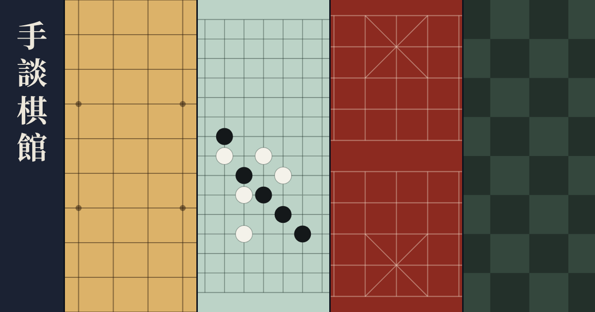

# 手談棋館



將棋、五子棋、象棋、西洋棋的入口網站。打開網頁就能下，不用註冊。

**[走進棋館](https://torusmith.github.io/QiguanGamets/)**

「手談」是下棋的古雅說法：兩個人不開口，用棋子交談。

## 四間棋室

| 棋室 | 可以做什麼 | 特色 | 原始碼 |
| --- | --- | --- | --- |
| [將棋](https://shtoruogigamets.pages.dev/) | 對電腦、線上對戰、詰將棋、復盤分析 | 入玉宣言、駒落ち、KIF／SFEN | [ShogiGamets](https://github.com/ToruSmith/ShogiGamets) |
| [五子棋](https://gomokugamets.pages.dev/) | 對電腦、線上對戰、殘局、賽後分析 | 連珠禁手、線上棋鐘、棋譜連結 | [GomokuGamets](https://github.com/ToruSmith/GomokuGamets) |
| [親子象棋](https://online-2-player-chinese-chess.onrender.com/) | 線上對戰、和電腦練習、殘局、學下棋 | 四位數代碼、讓子開局、長將與長捉判定 | [Online-2-Player-Chinese-Chess](https://github.com/ToruSmith/Online-2-Player-Chinese-Chess) |
| [西洋棋](https://chesstorusgamets.pages.dev/) | 對電腦、線上對戰、戰術題、賽後分析 | Stockfish、FIDE 和棋規則、PGN | [ChessTorusGamets](https://github.com/ToruSmith/ChessTorusGamets) |

親子象棋放在 Render 的免費方案，閒置後會休眠，第一次開啟可能要等一分鐘左右。

## 棋館怎麼運作

棋館只負責帶路，不放遊戲。四個遊戲各自開發、各自部署，也各自保存資料，其中一個更新或故障都不會影響其他棋室。

- 純靜態頁面，沒有 JavaScript，也沒有分析或追蹤程式。
- 棋盤與預覽圖都由程式產生，不使用外部圖片。
- 沒有帳號與跨遊戲戰績，戰績留在各遊戲自己的瀏覽器資料裡。

## 開發

需要 Node.js 22 以上，沒有任何 npm 相依。

```bash
npm test
npm run build
```

輸出在 `dist/`，用任何靜態伺服器打開都可以。

| 位置 | 內容 |
| --- | --- |
| `src/games.json` | 棋室清單，網址與文案都改這裡 |
| `src/boards.mjs` | 四種棋盤的 SVG |
| `src/index.template.html` | 頁面骨架、分享預覽與安全設定 |
| `src/styles.css` | 四扇棋屏的配色與版面 |
| `scripts/build.mjs` | 產生靜態網站 |
| `tests/site.test.mjs` | 驗證棋室清單與輸出的頁面 |

新增棋種時，除了 `games.json`，還要在 `boards.mjs` 畫棋盤、在 `styles.css` 加配色。

## 部署

使用 GitHub Pages。推送到 `main` 後，`.github/workflows/deploy.yml` 會測試、建置並發布 `dist/`。

第一次設定時，到 **Settings → Pages → Source** 選 **GitHub Actions**。

## 授權

本專案程式碼未採用開源授權，著作權由作者保留。第三方素材見 [THIRD_PARTY_NOTICES.md](THIRD_PARTY_NOTICES.md)。

四個遊戲的授權各自獨立，請見各自的儲存庫；其中西洋棋採 GPL-3.0。
